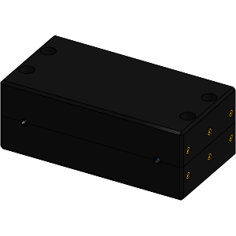
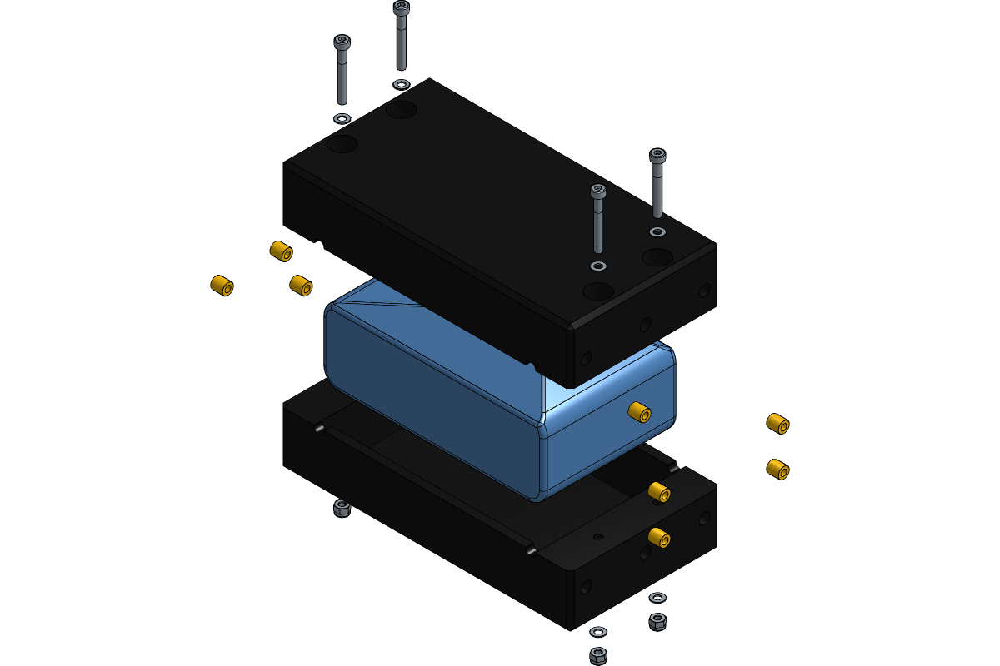

# Lidar Module

<!-- onshape-export:start -->
## CAD Model

- [Onshape document](https://cad.onshape.com/documents/ac588a7eb5b28f6e253c36ae/w/bc09979a038c263a7fdeab60/e/9c3580491767c4fcccc697de)
- [Complete assembly as STEP](assembly/complete-assembly.step)
- [Interactive 3D view as STL](assembly/complete-assembly.stl)
- [STL, STEP, and 3MF files for printable parts](parts)

### Exploded Views

#### Explode 1

## Bill of Materials

| Item | Component | Description | Quantity | Material | Mass |
| --- | --- | --- | --- | --- | --- |
| 1 |  |  | 2 | PLA Basic - 15% infill | 68.043 g |
| 2 |  |  | 1 | Li-Ion Battery | 485 g |
| 3 |  | Hex socket head cap screw M3x0.50 x 25 x 18 Stainless Steel  | 4 | Stainless Steel | 1.86 g |
| 4 | Fasteners | Chamfered plain washer normal M3 Stainless Steel  | 8 | Stainless Steel | 0.077 g |
| 5 |  | Prevailing torque thin nut grade A M3x0.5 Stainless Steel  | 4 | Stainless Steel | 0.594 g |
| 6 |  |  | 12 | Brass | 0.85 g |
<!-- onshape-export:end -->
