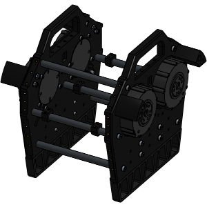
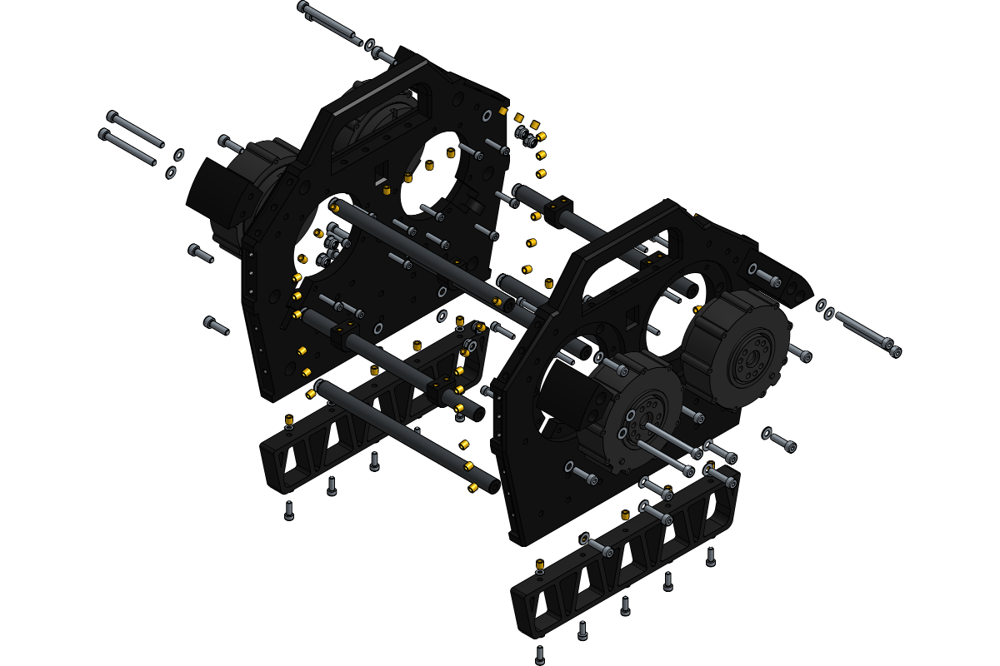

# Lidar Module

<!-- onshape-export:start -->
## CAD Model

- [Onshape document](https://cad.onshape.com/documents/35ce9c5c58fb7705d17ee463/w/db42703306dba14311ddd608/e/299da94b713685627f625add)
- [Complete assembly as STEP](assembly/complete-assembly.step)
- [Interactive 3D view as STL](assembly/complete-assembly.stl)
- [STL, STEP, and 3MF files for printable parts](parts)

### Exploded Views

#### Explode 1

## Bill of Materials

| Item | Component | Description | Quantity | Material | Mass |
| --- | --- | --- | --- | --- | --- |
| 1 |  |  | 6 | Carbon fiber epoxy (61%) | 9.979 g |
| 2 |  |  | 12 | PLA | 0.468 g |
| 3 |  |  | 12 | Brass | 0.615 g |
| 4 |  |  | 2 | PLA Basic - 15% infill | 10.637 g |
| 5 |  |  | 2 | PLA Basic - 15% infill | 10.637 g |
| 6 |  |  | 54 | Brass | 0.375 g |
| 7 |  |  | 2 | PLA Basic - 15% infill | 170.097 g |
| 8 |  |  | 2 | TPU | 35 g |
| 9 |  | Hex socket head cap screw M3x0.50 x 10 Stainless Steel  | 10 | Stainless Steel | 1.04 g |
| 10 | Fasteners | Chamfered plain washer normal M3 Stainless Steel  | 38 | Stainless Steel | 0.077 g |
| 11 | Screw | Chamfered plain washer normal M4 Stainless Steel  | 38 | Stainless Steel | 0.263 g |
| 12 |  | Hex socket head cap screw M4x0.70 x 45 Stainless Steel  | 8 | Stainless Steel | 5.437 g |
| 13 |  | Prevailing torque thin nut grade A M4x0.7 Stainless Steel  | 8 | Stainless Steel | 1.174 g |
| 14 |  | Hex socket head cap screw M4x0.70 x 15 Stainless Steel  | 14 | Stainless Steel | 2.519 g |
| 15 |  |  | 4 | Aluminum | 316 g |
| 16 |  | Hex socket head cap screw M3x0.50 x 16 Stainless Steel  | 24 | Stainless Steel | 1.368 g |
| 17 |  | Hex socket head cap screw M4x0.70 x 18 Stainless Steel  | 8 | Stainless Steel | 2.81 g |
| 18 |  |  | 12 | Brass | 0.253 g |
| 19 |  |  | 6 | PLA | 5 g |
<!-- onshape-export:end -->
