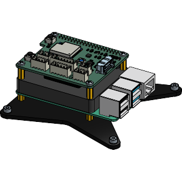
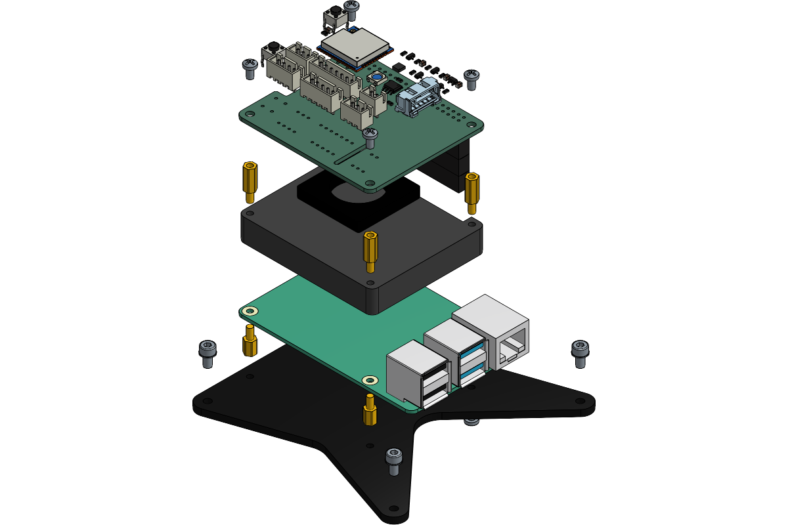

# Computer Module

<!-- onshape-export:start -->
## CAD Model

- [Onshape document](https://cad.onshape.com/documents/53844ad6c00962c6840fe6a2/w/f110ede8a45e576f2ae58e08/e/80abc9b6b67ad166a6cbb207)
- [Complete assembly as STEP](assembly/complete-assembly.step)
- [Interactive 3D view as STL](assembly/complete-assembly.stl)
- [STL, STEP, and 3MF files for printable parts](parts)

### Exploded Views

#### View 1

## Bill of Materials

| Item | Component | Description | Quantity | Material | Mass |
| --- | --- | --- | --- | --- | --- |
| 1 | Electronics | Cyberboard - Raspbery PI 4 Hat | 1 | N/A |  |
| 2 | Electronics | Raspberry PI 4 Model B | 1 | N/A | 46 g |
| 3 | Electronics | Heatsink | 1 | Hardened Alloy Steel | 35 g |
| 4 | 3D Print | Platform Attachment | 1 | Bambulab Basic PLA 15% infill | 16 g |
| 5 | Fasteners | M2.5 x 10mm hex standoff | 4 | Brass | 1.205 g |
| 6 | Fasteners | M2.5 x 6mm hex standoff | 4 | Brass | 0.823 g |
| 7 | Electronics | Brushless, 5V, 2 Pin, 30 x 30 x 4.6mm, DC Fan | 1 | PETG | 3.501 g |
| 8 | Fasteners | PH Pan head screw M2.5x0.45 x 5 Stainless Steel  | 8 | Stainless Steel | 0.395 g |
| 9 | Fasteners | Hex socket head cap screw M3x0.50 x 6 Stainless Steel  | 4 | Stainless Steel | 0.821 g |
| 10 | Fasteners | Chamfered plain washer normal M3 Stainless Steel  | 4 | Stainless Steel | 0.077 g |
<!-- onshape-export:end -->
