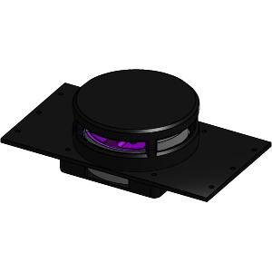

# Lidar Module

<!-- onshape-export:start -->
## CAD Model

- [Onshape document](https://cad.onshape.com/documents/906d2850ff2c946ea718e975/w/b27195ec2e07c0ce8fd3e7a9/e/e6c8cdd0630e6755fc9c4d80)
- [Complete assembly as STEP](assembly/complete-assembly.step)
- [Interactive 3D view as STL](assembly/complete-assembly.stl)
- [STL, STEP, and 3MF files for printable parts](parts)

## Bill of Materials

| Item | Component | Description | Quantity | Material | Mass |
| --- | --- | --- | --- | --- | --- |
| 1 | 3D Part |  | 1 | PLA Basic - 15% infill | 0.937 lb |
| 2 | Fasteners | Chamfered plain washer normal M3 Stainless Steel  | 4 | Stainless Steel | 0 lb |
| 3 |  | 3D Print | 1 | PLA Basic - 15% infill | 0.783 lb |
| 4 |  |  | 1 | PLA Basic - 15% infill | 1.617 lb |
| 5 |  |  | 1 |  |  |
| 6 |  |  | 4 | Brass | 0 lb |
| 7 |  |  | 4 | Brass | 0.001 lb |
<!-- onshape-export:end -->
