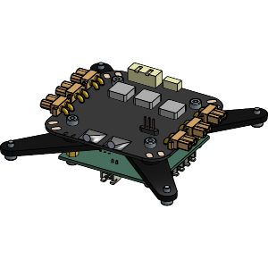
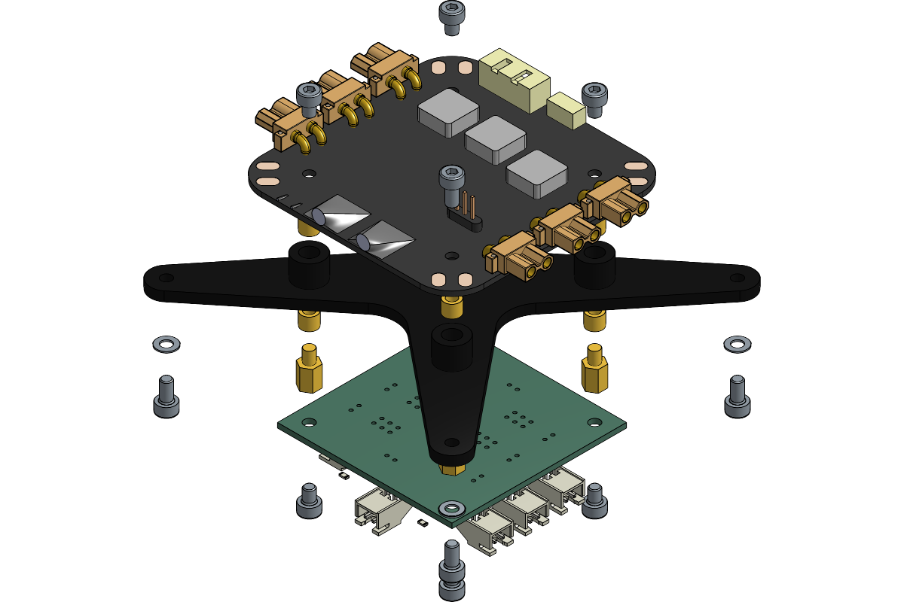

# Lidar Module

<!-- onshape-export:start -->
## CAD Model

- [Onshape document](https://cad.onshape.com/documents/1752d8c318982a332fe9b4df/w/6124955b43e56dc528ccc548/e/e3f261e3dcc42a364e314a40)
- [Complete assembly as STEP](assembly/complete-assembly.step)
- [Interactive 3D view as STL](assembly/complete-assembly.stl)
- [STL, STEP, and 3MF files for printable parts](parts)

### Exploded Views

#### Explode 1

## Bill of Materials

| Item | Component | Description | Quantity | Material | Mass |
| --- | --- | --- | --- | --- | --- |
| 1 |  |  | 1 | PLA | 13.154 g |
| 2 |  |  | 8 | Brass | 0.374 g |
| 3 |  |  | 4 | Brass | 1.2 g |
| 4 |  |  | 1 |  |  |
| 5 |  |  | 1 |  |  |
| 6 |  |  | 1 |  |  |
| 7 |  |  | 1 |  |  |
| 8 |  |  | 1 |  |  |
| 9 |  |  | 1 |  |  |
| 10 |  |  | 1 |  |  |
| 11 | Fasteners | Chamfered plain washer normal M3 Stainless Steel  | 4 | Stainless Steel | 0.077 g |
| 12 | Fasteners | Hex socket head cap screw M3x0.50 x 6 Stainless Steel  | 5 | Stainless Steel | 0.821 g |
| 13 |  | Hex socket head cap screw M3x0.50 x 4 Stainless Steel  | 7 | Stainless Steel | 0.711 g |
| 14 |  |  | 1 |  |  |
| 15 |  |  | 8 |  |  |
| 16 |  |  | 2 |  |  |
<!-- onshape-export:end -->
